# Melo V2 — Master Implementation Plan

**Product:** Melo V2  
**Specification Reference:** `MELO_V2_MASTER_PRD.md`  
**Status:** In Execution  

---

## Architecture Overview

```mermaid
flowchart TD
    subgraph AndroidClient ["Melo V2 Android App (Kotlin / Compose)"]
        UI["Compose UI Screens\n(Home, Search, Library, Account, Admin-removed)"]
        PlayerEngine["Media3 / ExoPlayer Engine\n(Offline Cache, Background Service)"]
        RoomDB["Local Room DB (v28+)\n(Offline-first source of truth)"]
        SyncManager["Cloud Sync Manager\n(WorkManager, Idempotent Cursors)"]
        FirebaseAuthClient["Firebase Auth SDK\n(Google Sign-In, Email/Password)"]
        FCMService["Firebase Messaging Service\n(Announcements, Release Alerts)"]
    end

    subgraph GoBackend ["Melo V2 Go REST API (/v1)"]
        AuthMiddleware["Firebase Auth Middleware\n(ID Token Verification, UID Upsert)"]
        UserHandler["User & Profile Handlers\n(/v1/me, /v1/me/preferences)"]
        SyncHandler["Sync Handlers\n(/v1/sync/push, /v1/sync/pull)"]
        PlaylistHandler["Playlists & Community\n(/v1/playlists, /v1/community)"]
        AssetHandler["Media Assets Service\n(Cloudflare R2 Presigned URLs)"]
        FCMHandler["FCM Push Service\n(Firebase Admin SDK)"]
        ReleaseHandler["Release & App Update Service\n(/v1/app/update, SHA-256 Validation)"]
        AdminHandler["Admin RBAC Handlers\n(Overview, Users, Reports, Releases)"]
    end

    subgraph StorageAndCloud ["Cloud Infrastructure"]
        NeonDB[("Neon PostgreSQL\n(Users, Library, Playlists, Releases, Logs)")]
        CloudflareR2[("Cloudflare R2 Storage\n(Avatars, Playlist Covers, Banners)")]
        FirebaseCloud["Firebase Platform\n(Auth Tokens, FCM Device Messaging)"]
    end

    subgraph AdminDashboard ["Melo V2 Admin Dashboard (Next.js / TS)"]
        AdminWebUI["Next.js Responsive Dashboard\n(Overview, User Management, Releases, Banners)"]
    end

    UI --> RoomDB
    UI --> PlayerEngine
    SyncManager -->|Idempotent HTTPS Mutations| SyncHandler
    FirebaseAuthClient -->|ID Tokens| AuthMiddleware
    FCMService <--|Push Events| FCMHandler

    AuthMiddleware --> NeonDB
    UserHandler --> NeonDB
    SyncHandler --> NeonDB
    PlaylistHandler --> NeonDB
    ReleaseHandler --> NeonDB
    AdminHandler --> NeonDB

    AssetHandler --> CloudflareR2
    FCMHandler --> FirebaseCloud
    AdminWebUI -->|Bearer ID Token| GoBackend
```

---

## Staged Implementation Plan

### Phase 1 — V2 Foundation & Go Backend Skeleton (P0)
- [x] Initialize `backend/` directory with Go 1.25 module (`melo-backend`).
- [x] Implement configuration loader with environment variables (`.env`).
- [x] Create PostgreSQL connection pool with `pgxpool`.
- [x] Set up versioned SQL migrations (`migrations/`) with complete initial schema:
  - `users`
  - `user_settings`
  - `user_devices`
  - `media_assets`
  - `user_library_items`
  - `playlists`, `playlist_tracks`, `playlist_members`, `playlist_follows`
  - `listening_history`
  - `sync_mutations`
  - `announcements`
  - `app_releases`
  - `feature_flags`
  - `reports`
  - `admin_roles`
  - `admin_audit_logs`
- [x] Implement health check (`/v1/health`, `/v1/ready`) endpoints.
- [x] Implement Firebase ID token verification middleware.
- [x] Generate OpenAPI 3.1 contract (`docs/openapi.yaml`).

### Phase 2 — Authentication & Profile Management (P0)
- [x] Implement `/v1/me` profile endpoints (fetch, update profile, username availability check).
- [x] Implement account deletion request and data export (`/v1/me/account-deletion`, `/v1/me/export`).
- [x] Android integration:
  - Add Firebase Auth dependency via Firebase Android BoM.
  - Implement `MeloAuthRepository` with Google Sign-in and Email/Password.
  - Maintain optional Guest / Local-only mode as default.
  - Add Account Screen with Sign In / Sign Out / Profile edit.

### Phase 3 — Cloud Library Sync (P0)
- [x] Implement `/v1/sync/push` and `/v1/sync/pull?cursor=...` with transactional monotonic cursors.
- [x] Android integration:
  - Map Room database entities (`SongEntity`, `PlaylistEntity`, `PlaylistSongMap`) to sync DTOs.
  - Build `MeloCloudSyncManager` with background sync and retry policies.
  - Implement deterministic conflict resolution using server revision + client mutation IDs.
  - Add Guest-to-Account merge preview and migration logic.

### Phase 4 — Cloudflare R2 Asset Uploads & Push Notifications (P0)
- [x] Implement R2 presigned PUT upload generator (`/v1/uploads/presign`) and completion verifier (`/v1/uploads/complete`).
- [x] Integrate Firebase Cloud Messaging (FCM) in Go backend using Firebase Admin Go SDK.
- [x] Implement device registration (`/v1/me/devices`, `DELETE /v1/me/devices/{install_id}`).
- [x] Android integration:
  - Add `MeloFirebaseMessagingService` with token auto-registration.
  - Upload avatar / custom playlist cover via `MeloUploadManager` presigned URLs.
  - Handle FCM push notifications for announcements and app releases.

### Phase 5 — Admin Management & Controlled App Releases (P0)
- [x] Build Next.js 15 admin dashboard in `admin/`:
  - Firebase Web Auth integration (`login/page.tsx`).
  - Dashboard Overview with live backend metrics.
  - User management (search, suspend, restore, role assignments).
  - Announcements editor (draft, schedule, publish, trigger FCM).
  - App Release manager (upload APK artifact, set version code/name, min version, channel, SHA-256).
  - Moderation Reports queue (`reports/page.tsx`).
  - Audit logs viewer.
- [x] Android App Update Client:
  - Point to `/v1/app/update`.
  - Validate package name (`com.music.melo`), version code, and SHA-256 before invoking PackageInstaller.
  - Remove legacy Supabase client code completely from Android.

### Phase 6 — Community & Playlists (P1)
- [x] Implement public and unlisted playlists with deep share links (`/playlist/{id}`).
- [x] Implement playlist following and collaboration roles (`editor`, `viewer`).
- [x] Implement reporting system (`/v1/reports`, `/v1/community/reports`, `/v1/admin/reports`).
- [x] Integrate report dialog in Android client (`ReportContentDialog`).

### Phase 7 — Playback & Test Fixes (P0/P1)
- [x] Fix baseline unit test failure in `TogetherGuestPlaybackPlannerTest`.
- [x] Run full test suites across Android, Backend, and Admin.

### Phase 8 — Hardening, Runbooks & Documentation
- [x] Write `docs/architecture.md`, `docs/database.md`, `docs/api.md`, `docs/deployment.md`, `docs/release-runbook.md`.
- [x] Final security audit and `SECURITY_REVIEW.md` verification.
- [x] Record all build and test commands in `CHANGELOG.md`.
