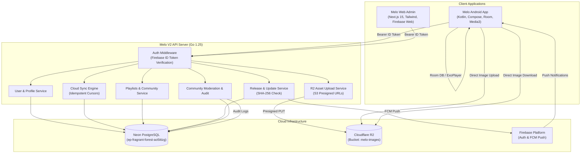

# Melo V2 — System Architecture

## 1. System Overview

Melo V2 is a modern, privacy-first, offline-capable music streaming and library management platform. It combines a native Android client (Jetpack Compose, Room, Media3) with a robust Go 1.25 REST API backend, Neon serverless PostgreSQL, Cloudflare R2 object storage, Firebase Authentication & Cloud Messaging (FCM), and a standalone Next.js 15 administration console.

---

## 2. Core Architectural Pillars

### 2.1 Offline-First Primacy
The Android client uses Room database (version 28+) as its authoritative local cache and player source. 
- Local audio playback, liked songs, queue management, and downloads are 100% functional without an internet connection or user account.
- Background sync (`MeloCloudSyncManager`) operates asynchronously via Android `WorkManager` or coroutine scopes, never blocking UI rendering or audio pipelines.

### 2.2 Privileged Backend Boundary
All relational database writes, role verifications, and external storage credentials are concentrated in the Go REST API (`/v1`).
- Client applications **never** hold database credentials or master cloud keys.
- Direct database connections (Neon PostgreSQL) are pooled via `pgxpool`.
- Supabase client libraries and in-app administrative surfaces have been completely eliminated.

### 2.3 Asset Management via S3-Compatible Presigned URLs
Media assets (profile avatars, playlist covers, release banners) are handled via Cloudflare R2:
1. Client requests an upload token from Go backend: `POST /v1/uploads/presign`.
2. Backend validates MIME types (`image/jpeg`, `image/png`, `image/webp`), size limits (5 MB max), generates an authenticated S3 PUT URL with a 5-minute TTL.
3. Client PUTs binary bytes directly to Cloudflare R2.
4. Client notifies backend: `POST /v1/uploads/complete`, which verifies the asset in Neon DB.
5. Assets are distributed globally through Cloudflare's public CDN (`https://pub-65f5c567634e486682c0d063bc40dd16.r2.dev/`).

---

## 3. Data Synchronization Architecture

Synchronization between the local Room DB and the Neon PostgreSQL cloud database is transactional and monotonic:

1. **Mutation Ledger (`sync_mutations`):**
   - Every state change (like track, unlike track, create playlist, update playlist, add track) creates a unique `client_mutation_id` (UUIDv4) and entity payload.
2. **Push (`POST /v1/sync/push`):**
   - The Android client batches unpushed local mutations and posts them to `/v1/sync/push`.
   - The Go backend verifies user ownership, applies mutations transactionally, advances the monotonic sequence cursor, and returns the applied mutation IDs.
3. **Pull (`GET /v1/sync/pull?cursor={cursor}`):**
   - The client polls or pulls incremental remote changes using its last acknowledged cursor.
   - Any remote updates from another device or web console are merged locally into Room DB deterministically.

---

## 4. Security & Compliance Boundaries

- **Authentication:** Firebase Authentication provides secure Email/Password and Google Sign-In. ID tokens are passed as `Authorization: Bearer <token>` and verified by Go backend middleware using public keys.
- **Role-Based Access Control (RBAC):** Admin authorization (`super_admin`, `content_manager`, `moderator`) is validated strictly against the `admin_roles` table in Neon PostgreSQL.
- **Audio Streaming Compliance:** Audio streams are fetched directly by the ExoPlayer / Media3 engine from upstream providers. The Melo backend neither routes, proxies, nor caches copyrighted audio streams.
